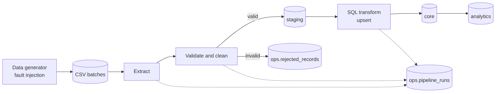

# CampusPulse: Campus Placement Data Platform

An end-to-end, batch data engineering project built with Python and PostgreSQL. It ingests messy placement-style CSV files, validates and cleans them, quarantines bad rows with reasons, loads data idempotently, and produces analytics tables. Every run is logged and auditable.

> **Disclaimer (put this at the top of the final README):** All data in this project is synthetic and generated by a script in this repository. CampusPulse is an independent, campus-inspired project. It is not an official IIT Guwahati system and does not use or represent real placement data.

---

## 1. Purpose and positioning

**Goal:** Show a recruiter that I can design and build a reliable data pipeline, not just write SQL queries.

**What the project proves:**
- I can ingest unreliable data and decide what to accept, fix, or reject.
- I can make loads safe to repeat (idempotency) and handle changed or late records.
- I can measure pipeline health (rows read, loaded, rejected, per run).
- I can model data in layers and write analytical SQL.
- I can test, containerize, and document my work so someone else can run it in one command.

**One-line pitch for the recruiter:**
"A batch pipeline that takes dirty placement CSVs, quarantines invalid rows with reasons, loads clean data idempotently into PostgreSQL, and produces analytics tables, with run-level audit logs and tests proving a replayed batch changes nothing."

---

## 2. Scope

### In scope (core, must finish)
1. Synthetic data generator with configurable fault injection
2. Python ETL pipeline: extract, validate, clean, load
3. PostgreSQL with layered schemas (raw, staging, core, analytics, ops)
4. Rejected-record quarantine with reason codes
5. Idempotent, incremental loading (file-level and row-level)
6. Run metadata and data quality metrics
7. SQL transformations and analytics queries
8. Automated tests (pytest)
9. Docker Compose setup and one-command run (Makefile)
10. Professional README with diagram, design decisions, and sample outputs

### Stretch (only after core is done and verified)
- Orchestration with Airflow (one DAG) **or** dbt models and tests for the analytics layer (pick one, not both)
- GitHub Actions CI running tests against a Postgres service
- Scale test with about 1M rows and an indexing/`EXPLAIN` comparison
- Simple dashboard (Metabase or a Streamlit page) over the analytics schema

### Out of scope
Spark, Kafka, cloud deployment, real-time streaming, real student data. These can be listed under "Future work" in the README, clearly marked as not built.

---

## 3. Architecture

```
          +---------------------------+
          |  Synthetic data generator |  (seeded, fault injection)
          +-------------+-------------+
                        |  CSV batches (batch_001, batch_002, ...)
                        v
   +--------------------+---------------------+
   |            Python pipeline               |
   |  extract -> validate -> clean -> load    |
   |  (file checksums, row hashes, logging)   |
   +----+-----------------+-------------+-----+
        |                 |             |
        v                 v             v
   raw.*  (as received)  staging.*   ops.rejected_records
                         (typed,     ops.pipeline_runs
                          cleaned)   ops.file_ingestions
                            |
                            v  SQL transformations (upserts)
                         core.*  (students, companies,
                                  applications, offers)
                            |
                            v
                         analytics.*  (views / tables for reporting)
```

### Mermaid version (renders on GitHub, use in README)



### Layer responsibilities

| Layer | Schema | Purpose |
|---|---|---|
| Raw | `raw` | Rows exactly as received (all text), plus batch and file metadata. Enables replay and debugging. |
| Staging | `staging` | Typed, trimmed, standardized rows that passed validation. Temporary per batch. |
| Core | `core` | Clean, deduplicated, constraint-enforced tables (PKs, FKs). Source of truth. |
| Analytics | `analytics` | Aggregated tables or views for reporting. |
| Ops | `ops` | Pipeline runs, file ingestions, rejected records, quality metrics. |

---

## 4. Tech stack

| Area | Choice | Why |
|---|---|---|
| Language | Python 3.11+ | Standard for DE tooling |
| Database | PostgreSQL 16 | Strong SQL, `ON CONFLICT`, window functions, `percentile_cont` |
| DB driver | `psycopg` (v3) | Bulk loading via `COPY` |
| Data handling | `pandas` (validation and cleaning) | Fast to write; keep logic in small testable functions |
| Config | `.env` + a small `config.py` | No hardcoded credentials |
| Logging | Python `logging`, JSON or structured lines | Log per stage with batch ID |
| Testing | `pytest` | Unit and integration tests |
| Packaging | Docker Compose, Makefile | One-command setup and run |
| Lint/format | `ruff` | Clean repo signal |
| Stretch | Airflow or dbt, GitHub Actions | Industry tooling awareness |

---

## 5. Data model

### 5.1 Core tables

```sql
-- core.students
student_id        TEXT PRIMARY KEY,
department        TEXT NOT NULL,
graduation_year   INT  NOT NULL,
cgpa              NUMERIC(3,2),
row_hash          TEXT NOT NULL,
first_loaded_at   TIMESTAMPTZ NOT NULL DEFAULT now(),
last_updated_at   TIMESTAMPTZ NOT NULL DEFAULT now(),
last_batch_id     TEXT NOT NULL

-- core.companies
company_id        TEXT PRIMARY KEY,
company_name      TEXT NOT NULL,          -- standardized
company_name_raw  TEXT,                   -- as received (first seen)
sector            TEXT NOT NULL,
row_hash          TEXT NOT NULL,
first_loaded_at   TIMESTAMPTZ NOT NULL DEFAULT now(),
last_updated_at   TIMESTAMPTZ NOT NULL DEFAULT now(),
last_batch_id     TEXT NOT NULL

-- core.applications
application_id    TEXT PRIMARY KEY,
student_id        TEXT NOT NULL REFERENCES core.students,
company_id        TEXT NOT NULL REFERENCES core.companies,
applied_at        DATE NOT NULL,
status            TEXT NOT NULL CHECK (status IN
                  ('applied','shortlisted','interviewed','offered','rejected','withdrawn')),
row_hash          TEXT NOT NULL,
first_loaded_at   TIMESTAMPTZ NOT NULL DEFAULT now(),
last_updated_at   TIMESTAMPTZ NOT NULL DEFAULT now(),
last_batch_id     TEXT NOT NULL

-- core.offers
offer_id          TEXT PRIMARY KEY,
student_id        TEXT NOT NULL REFERENCES core.students,
company_id        TEXT NOT NULL REFERENCES core.companies,
compensation_lpa  NUMERIC(6,2) NOT NULL CHECK (compensation_lpa > 0),
offer_date        DATE NOT NULL,
row_hash          TEXT NOT NULL,
first_loaded_at   TIMESTAMPTZ NOT NULL DEFAULT now(),
last_updated_at   TIMESTAMPTZ NOT NULL DEFAULT now(),
last_batch_id     TEXT NOT NULL
```

### 5.2 Ops tables

```sql
-- ops.file_ingestions   (file-level idempotency)
file_name, batch_id, file_checksum (sha256), rows_in_file,
status ('processed','skipped_duplicate','failed'), ingested_at
UNIQUE (file_name, file_checksum)

-- ops.pipeline_runs
run_id (uuid), batch_id, started_at, finished_at, status ('success','partial','failed'),
rows_read, rows_loaded_new, rows_updated, rows_unchanged, rows_rejected,
error_message

-- ops.rejected_records
id, run_id, batch_id, source_table, source_row_number,
reason_code, reason_detail, raw_payload (JSONB), rejected_at

-- ops.quality_metrics
run_id, table_name, metric_name, metric_value, recorded_at
-- examples: null_rate_company_name, duplicate_rate_applications, orphan_rate_offers
```

### 5.3 Relationships

```
students 1---* applications *---1 companies
students 1---* offers       *---1 companies
```

---

## 6. Synthetic data generator

**File:** `src/generate_data.py`
Run with a seed so output is reproducible: `python -m src.generate_data --seed 42 --students 5000 --out data/sample`

### 6.1 Clean-data realism
- Departments: realistic list (e.g. Chemical, Computer Science, Electronics, Mechanical, Civil, Design, Physics, Mathematics).
- Graduation years: current and next two years.
- About 40 to 80 companies across sectors (Software, Fintech, Consulting, Core Engineering, Analytics, Product, Hardware).
- Applications per student: skewed distribution (some students apply to many, some to few).
- Status funnel: applied, then shortlisted, then interviewed, then offered or rejected, with realistic drop-off.
- Compensation: log-normal style distribution with sector-dependent medians, plus a few high outliers.
- Offers only come from applications that reached the `offered` status (in clean data).

### 6.2 Fault injection (configurable rates)

| Fault | Example | Expected pipeline behavior |
|---|---|---|
| Exact duplicate rows | same application row twice | Dedupe, count in metrics |
| Duplicate key, different values | same `application_id`, different status | Keep latest by rule, log conflict |
| Missing required fields | null `student_id`, empty `company_name` | Reject: `MISSING_REQUIRED` |
| Invalid dates | `2025-13-45`, `31/02/2025`, future dates | Reject: `INVALID_DATE` |
| Date logic errors | `offer_date` before `applied_at` | Reject: `DATE_ORDER_VIOLATION` |
| Orphan foreign keys | application references unknown student/company | Reject: `ORPHAN_STUDENT` / `ORPHAN_COMPANY` |
| Messy company names | `Google`, `google inc.`, `GOOGLE LLC`, ` Google  ` | Standardize via normalization and alias map |
| Bad numeric values | compensation `-5`, `abc`, `1e9` | Reject: `INVALID_COMPENSATION` |
| Invalid enum values | status `"Selected!!"` | Reject: `INVALID_STATUS` |
| Wrong column order / missing column | schema drift in a file | Fail the file with a clear error, log it |
| Late-arriving records | old application appears in a later batch | Accepted, upserted correctly |
| Changed records | status moves from `interviewed` to `offered` | Detected by row hash, updated |

The generator also writes a **ground-truth manifest** (`faults_manifest.json`) listing exactly how many of each fault it injected per batch. The tests compare the pipeline's reject counts against this manifest. This is the strongest proof the pipeline works.

### 6.3 Batch design

| Batch | Contents | Purpose |
|---|---|---|
| `batch_001` | Initial full load with some faults | Baseline run |
| `batch_002` | New records, changed records, late arrivals, new faults | Incremental logic |
| `batch_003` | Exact replay of `batch_002` | Idempotency proof (zero net changes) |
| `batch_004` (optional) | Schema drift file | Failure handling demo |

---

## 7. Pipeline design

**Entry point:** `python -m src.pipeline --batch batch_001` (or `make run BATCH=batch_001`)

### 7.1 Stages

1. **Register run:** create a `pipeline_runs` row with status `running`.
2. **Extract:** read each CSV, compute SHA-256 checksum. If `(file_name, checksum)` already exists in `ops.file_ingestions` as processed, skip and log `skipped_duplicate`.
3. **Schema check:** verify required columns and column names. On failure, mark the file failed, log, continue with other files.
4. **Raw load:** bulk `COPY` all rows as text into `raw.*` with `batch_id` and `source_row_number`.
5. **Validate:** apply rules per table (section 7.2). Split into valid and rejected sets.
6. **Clean:** trim whitespace, normalize case, standardize company names, parse dates, cast types, compute `row_hash`.
7. **Deduplicate:** drop exact duplicates; resolve key conflicts with a documented rule (latest `applied_at` or latest file row wins).
8. **Stage load:** write valid rows into `staging.*`.
9. **Referential check:** validate FKs against `core` plus current batch (parents loaded before children).
10. **Upsert to core:** `INSERT ... ON CONFLICT (pk) DO UPDATE ... WHERE core.row_hash <> EXCLUDED.row_hash`. Count new, updated, unchanged.
11. **Quarantine write:** insert rejects with reason codes and JSON payload.
12. **Metrics:** compute and store quality metrics.
13. **Finalize run:** update `pipeline_runs` with counts and status.
14. **Transactions:** each table load runs inside a transaction so a failure never leaves half-loaded data.

### 7.2 Validation rules

| Table | Rule | Reason code |
|---|---|---|
| all | Required columns present | `SCHEMA_MISMATCH` (file level) |
| all | Primary key not null / not blank | `MISSING_PK` |
| students | `graduation_year` is an integer in a plausible range | `INVALID_YEAR` |
| students | `department` not blank | `MISSING_REQUIRED` |
| companies | `company_name` not blank; sector in allowed list | `MISSING_REQUIRED`, `INVALID_SECTOR` |
| applications | `applied_at` parses as a date, not in the future | `INVALID_DATE` |
| applications | `status` in allowed set | `INVALID_STATUS` |
| applications | `student_id` and `company_id` exist | `ORPHAN_STUDENT`, `ORPHAN_COMPANY` |
| offers | `compensation_lpa` numeric and within a sane range | `INVALID_COMPENSATION` |
| offers | `offer_date` valid and not before the student's application date | `INVALID_DATE`, `DATE_ORDER_VIOLATION` |
| offers | student and company exist | `ORPHAN_STUDENT`, `ORPHAN_COMPANY` |

### 7.3 Company name standardization
- Normalize: lowercase, trim, collapse spaces, strip punctuation, remove suffixes (`inc`, `llc`, `ltd`, `pvt`, `technologies` where appropriate).
- Map through an alias table (`config/company_aliases.csv`) to a canonical name.
- Unmapped names are kept as-is (normalized) and counted in a metric so the alias list can be improved.

### 7.4 Idempotency and incremental loading (explain this well in interviews)

| Mechanism | What it protects against |
|---|---|
| File checksum in `ops.file_ingestions` | Re-processing the same file |
| Primary keys + `ON CONFLICT DO UPDATE` | Duplicate rows on re-load |
| `row_hash` comparison | Updating only rows that truly changed (no pointless writes) |
| Single transaction per table load | Partial loads after a crash |
| Deterministic cleaning | Same input always gives the same output |

**Acceptance test:** run `batch_002` twice. After the second run, `core.*` row counts, content hashes, and `last_updated_at` for unchanged rows are identical, and the run log shows `rows_loaded_new = 0`, `rows_updated = 0`.

### 7.5 Failure handling

| Failure | Behavior |
|---|---|
| Bad row | Quarantine with reason, continue |
| Bad file (schema drift) | Mark file failed, continue other files, run status `partial` |
| Database error mid-load | Roll back that table's transaction, run status `failed`, error stored |
| Pipeline restart after crash | Safe to rerun; idempotency prevents duplicates |

---

## 8. SQL transformations and analytics

### 8.1 Analytics objects (`analytics` schema)

- `analytics.placement_summary`: overall placement rate by graduation year
- `analytics.department_offers`: offers, mean and median compensation by department
- `analytics.company_funnel`: applications, shortlists, interviews, offers, conversion rate per company
- `analytics.sector_trends`: offers and compensation by sector and month
- `analytics.pipeline_health`: rejects by reason per run (from `ops`)

### 8.2 Required queries (all in `sql/analytics.sql`)

1. How many students received at least one offer, and what is the placement rate by department?
2. Which companies received the most applications (top 10)?
3. Offer conversion rate by company and by sector.
4. Median and average compensation by department (`percentile_cont(0.5)`).
5. Top 3 companies per sector by offers (window function: `ROW_NUMBER() OVER (PARTITION BY ...)`).
6. Monthly offer trend with month-over-month change (`LAG`).
7. Students with multiple offers and their highest offer (CTE + window function).
8. Rejected records by reason code per pipeline run.
9. Data quality trend: reject rate across batches.
10. Applications stuck at a stage for more than N days (date logic).

### 8.3 Showcase concepts
CTEs, window functions, `FILTER` aggregates, `percentile_cont`, `LAG`, anti-joins for orphan detection, indexes on foreign keys and `applied_at`.

---

## 9. Testing strategy

### 9.1 Unit tests (`tests/unit/`)
- Date parsing (valid, invalid, edge cases such as Feb 30)
- Company name normalization and alias mapping
- Each validation rule produces the right reason code
- Row hash is stable and changes when a value changes
- Dedup conflict resolution

### 9.2 Integration tests (`tests/integration/`, uses a throwaway Postgres)
- **Full run:** `batch_001` loads; reject counts per reason match `faults_manifest.json`
- **Idempotency:** run the same batch twice; no changes on the second run
- **Incremental:** `batch_002` updates only changed rows and inserts only new rows
- **Replay:** `batch_003` yields zero net changes
- **Schema drift:** a file with missing columns is rejected and others still load
- **Referential integrity:** no orphan rows exist in `core` after any run
- **Rollback:** simulate a failure mid-load and confirm no partial data

### 9.3 Quality gates
- `ruff` passes
- Test coverage report (aim for a meaningful percentage on `src/`, not 100%)
- All tests run in CI (stretch)

---

## 10. Repository structure

```
campuspulse/
├── README.md
├── LICENSE
├── Makefile
├── docker-compose.yml
├── Dockerfile
├── requirements.txt
├── .env.example
├── .gitignore
├── config/
│   ├── settings.py
│   ├── company_aliases.csv
│   └── validation_rules.yml
├── data/
│   └── sample/                  # small committed sample batches
├── src/
│   ├── generate_data.py
│   ├── extract.py
│   ├── validate.py
│   ├── transform.py
│   ├── load.py
│   ├── quality.py
│   ├── db.py
│   ├── logging_setup.py
│   └── pipeline.py
├── sql/
│   ├── 00_schemas.sql
│   ├── 01_raw.sql
│   ├── 02_staging.sql
│   ├── 03_core.sql
│   ├── 04_ops.sql
│   ├── 05_transformations.sql
│   ├── 06_analytics_views.sql
│   └── analytics.sql
├── tests/
│   ├── unit/
│   └── integration/
├── docs/
│   ├── architecture.png
│   ├── data_model.png
│   └── sample_outputs/
├── dags/                        # stretch: Airflow DAG
└── .github/workflows/ci.yml     # stretch
```

---

## 11. Developer experience (one-command run)

```bash
git clone <repo> && cd campuspulse
cp .env.example .env
make up                 # starts Postgres (and applies schema)
make generate           # creates synthetic batches with a fixed seed
make run BATCH=batch_001
make run BATCH=batch_002
make run BATCH=batch_003   # replay: proves idempotency
make test
make report             # prints analytics and pipeline health summary
make down
```

`make demo` should chain all of the above so the recruiter can see everything with one command.

---

## 12. Final README outline

1. Title, one-line pitch, disclaimer (synthetic data, not an official IITG system)
2. Problem statement
3. Architecture diagram and layer explanation
4. Features (only what is built and verified)
5. Tech stack
6. Quick start (copy-paste commands, expected output)
7. Data model diagram
8. Fault injection table and how the pipeline responds
9. Idempotency and incremental loading explained, with proof (run logs showing the replay)
10. Data quality checks and reject reason codes
11. Sample outputs: run summary table, rejected-record breakdown, analytics query results (screenshots or tables)
12. Testing: how to run, what is covered
13. Design decisions and trade-offs (see section 13)
14. Limitations and future work (Airflow, dbt, Spark, streaming) clearly marked "not implemented"
15. Project structure

---

## 13. Design decisions to be ready to defend

| Decision | Reasoning |
|---|---|
| Layered schemas (raw, staging, core, analytics) | Separates ingestion fidelity, cleaning, trusted data, and reporting; allows replay and debugging |
| Keep raw as text | No data loss from failed casts; bad values can be inspected and quarantined |
| Quarantine instead of dropping | Nothing disappears silently; rejects are auditable and fixable |
| Row hash for change detection | Cheap comparison; avoids rewriting unchanged rows |
| File checksum plus PK upserts | Two levels of idempotency: skip known files, and be safe even if a changed file contains old rows |
| Batch, not streaming | Matches the data's nature (periodic exports); simpler and more reliable |
| Postgres only, no Spark | Data volume does not justify a distributed engine; I can explain when I would switch |
| `COPY` for bulk loads | Much faster than row-by-row inserts |
| Ground-truth fault manifest | Tests verify the pipeline against known injected faults rather than eyeballing |

---

## 14. Interview talking points

Be ready to answer these confidently:

1. **Walk me through the pipeline.** (stages in section 7.1, two minutes)
2. **What happens if I run it twice?** (file checksum, upserts, row hash; show the replay run)
3. **What happens to bad data?** (quarantine table, reason codes, manifest matching)
4. **How do you know a run was correct?** (run metadata, quality metrics, tests against ground truth)
5. **How would this scale to 100x data?** (partitioning, bulk loading, indexing, then Spark or a warehouse; mention what you measured if you did the scale test)
6. **How would you schedule it?** (Airflow DAG with retries and alerts; explain even if not built)
7. **What would you change next?** (CDC from a source system, dbt for transformations, data contracts, alerting)
8. **What went wrong while building it?** (have one honest story about a bug the tests caught)

---

## 15. Honest-claims checklist (verify before presenting)

Only list a feature in the README or say it aloud if every box is checked:

- [ ] Fresh clone runs with `make demo` on a clean machine
- [ ] Reject counts match the fault manifest
- [ ] Replay batch produces zero net changes (shown in logs and a test)
- [ ] FK integrity holds in `core` after every run
- [ ] A forced failure rolls back cleanly
- [ ] All analytics queries run and results are in the README
- [ ] Tests pass locally (and in CI if claimed)
- [ ] Airflow/dbt/CI claimed only if actually working
- [ ] Synthetic-data disclaimer present
- [ ] No secrets or real data committed

---

## 16. Definition of done

The project is ready to show when a recruiter can clone the repo, run one command, watch three batches process (including a faulty one and a replay), see rejects explained, see analytics results, run the tests, and read a README that explains every design choice, with nothing claimed that does not work.

---

## 17. Risks and mitigations

| Risk | Mitigation |
|---|---|
| Scope creep into tools | Core first; one stretch item only, and only after the core is verified |
| Generator becomes a time sink | Keep it simple, seeded, and manifest-driven; polish later |
| Idempotency bugs found late | Write the replay test as soon as upserts work, not at the end |
| Environment issues on demo | Docker Compose, pinned versions, test on a clean clone |
| Over-explaining in interview | Prepare a 2-minute and a 10-minute walkthrough |
