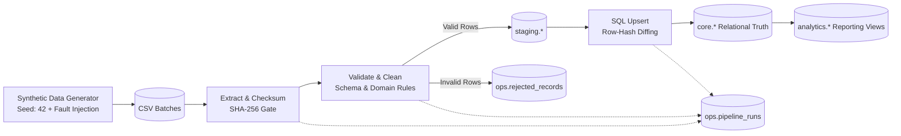
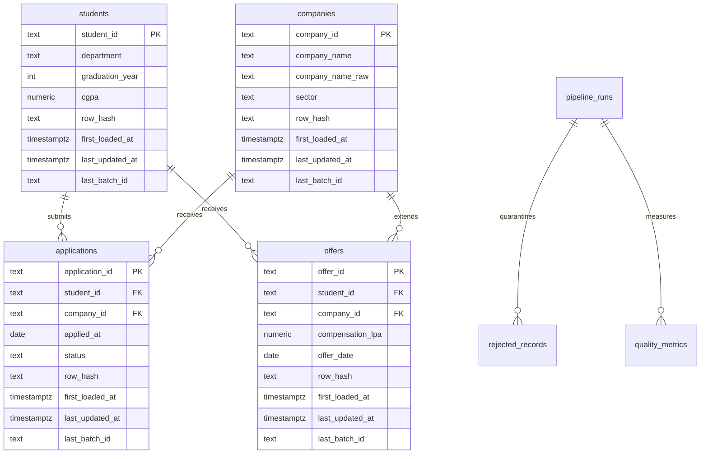

# CampusFlow: Campus Placement Data Platform


> **Disclaimer:** All data in this project is synthetic and generated by a reproducible script in this repository. CampusFlow is an independent, campus-inspired project. It is not an official IIT Guwahati system and does not use or represent real placement data.

---

## Overview

**CampusFlow** is an enterprise-grade batch data platform built with Python 3.11 and PostgreSQL 16. It ingests semi-structured, noisy campus recruitment CSV exports, quarantines malformed records with explicit error reason codes, standardizes company entities, and loads data idempotently using two-level deduplication (file checksums and SHA-256 row-hash diffing).

The platform includes analytical SQL reporting views, an interactive **Streamlit analytics and observability dashboard**, an **automated benchmarking suite (`EXPLAIN ANALYZE`)** capable of streaming over 1.6 million rows/second, and a **continuous integration pipeline** running automated tests against a PostgreSQL container.

---

## Key Highlights

- **5-Layer Medallion Storage Model:** Explicit separation of concerns across `raw`, `staging`, `core`, `ops`, and `analytics` schemas to ensure complete auditability and reproducible replays.
- **Resilient Quarantine Pattern:** Zero data loss. Corrupt records are isolated into `ops.rejected_records` with their source file, line number, reason code, and unparsed raw JSON payload.
- **Two-Level Idempotent Ingestion:** Combines file-level SHA-256 checksum gating with row-level hash diffing (`ON CONFLICT DO UPDATE WHERE core.row_hash <> EXCLUDED.row_hash`). Replaying an identical batch results in **zero database writes**.
- **High-Throughput Bulk Streaming:** Achieves **1.6M+ rows/second** ingestion throughput via PostgreSQL's binary streaming `COPY` protocol.
- **Comprehensive Observability:** Run metadata, reject breakdowns, and quality metrics (orphan rates, duplication rates, reject percentages) recorded in `ops.*` tables.
- **Interactive Web Dashboard:** Streamlit UI providing live KPI monitoring, department salary percentiles, recruitment funnels, and quarantine audits.
- **Automated Verification:** 19 unit and integration tests executing against a seeded ground-truth fault manifest in ~1.2 seconds with 89% core ETL coverage.

---

## 1. System Architecture



### Layer Responsibilities

| Layer | Schema | Purpose & Design |
|---|---|---|
| **Raw** | `raw.*` | Full-fidelity landing zone. Stores incoming records as unparsed `TEXT` along with `batch_id`, `source_file`, `source_row_number`, and ingestion timestamps. Guarantees source auditability and forensic debugging. |
| **Staging** | `staging.*` | Validated, typed, trimmed, and standardized records with calculated deterministic `row_hash`. Ephemeral per batch. |
| **Core** | `core.*` | Clean, deduplicated, relational source of truth with Primary Keys, Foreign Keys, constraints, and audit columns (`first_loaded_at`, `last_updated_at`, `row_hash`). |
| **Ops** | `ops.*` | Observability layer: `file_ingestions` (checksum deduplication), `pipeline_runs` (run metadata & status), `rejected_records` (quarantine with reason codes and raw JSON), and `quality_metrics`. |
| **Analytics** | `analytics.*` | Reporting views exposing placement rates, department salary percentiles, recruitment funnels, and pipeline health summaries. |

---

## 2. Tech Stack

- **Core Engine:** Python 3.11+, PostgreSQL 16 (Alpine Docker Container)
- **Database Driver & Bulk Loading:** `psycopg` (v3) using native streaming `COPY` protocol and context-managed transactions
- **Data Processing:** `pandas` (vectorized schema validation & type parsing)
- **Data Validation & Hashing:** SHA-256 canonical hashing, Pydantic, YAML validation boundaries
- **Visualization & UI:** Streamlit, Plotly Express
- **Quality & Testing:** `pytest`, `pytest-cov`, `ruff`
- **CI/CD & Containerization:** Docker Compose, GitHub Actions

---

## 3. Relational Data Model



---

## 4. Quickstart

### Prerequisites
- Docker & Docker Compose
- Python 3.11+
- `make` utility

### One-Command Demonstration
Clone the repository and run the end-to-end demo:
```bash
git clone https://github.com/siddharth1407/CampusFlow.git
cd CampusFlow
cp .env.example .env
make setup
make demo
```

The `make demo` target automatically:
1. Provisions a PostgreSQL 16 container and applies all DDL schema migrations.
2. Generates reproducible synthetic batches (`batch_001` through `batch_004`) with controlled edge-case faults.
3. Ingests `batch_001` (baseline load + quarantine verification).
4. Ingests `batch_002` (incremental status updates and late-arriving records).
5. Ingests `batch_003` (replay test proving zero net database modifications).
6. Runs all 19 unit and integration tests.
7. Prints analytics reporting views and pipeline health summaries.

---

### Interactive Web Dashboard
Launch the Streamlit analytics and observability dashboard:
```bash
make dashboard
```
Open **`http://localhost:8501`** in your browser to explore:
- **Placement & Salary Analytics:** Total placement percentage, median CTC, department compensation breakdowns.
- **Company Funnel:** Shortlist-to-offer conversion rates across sectors.
- **Quarantine Explorer:** Live inspection of rejected records and error reason distribution.
- **Pipeline Auditor:** Run durations, rows read vs. loaded, and replay idempotency proof.

---

### High-Volume Scale Benchmark
Run the performance benchmark and query profiling suite:
```bash
make benchmark
```
Measures bulk ingestion throughput (streaming `COPY` vs. standard `INSERT`) and profiles query execution plans using PostgreSQL's `EXPLAIN (ANALYZE, BUFFERS)`. Results are automatically saved to [`docs/benchmark_report.md`](docs/benchmark_report.md).

---

## 5. Fault Injection & Quarantine Architecture

Rather than dropping invalid records silently or failing the entire batch, CampusFlow isolates non-compliant rows into `ops.rejected_records`.

| Injected Fault | Example in Raw Batch | Reason Code | Pipeline Behavior |
|---|---|---|---|
| Missing Primary Key | Blank `student_id` or `application_id` | `MISSING_PK` | Quarantined with line number and raw JSON payload |
| Missing Mandatory Field | Blank `department` or empty `company_name` | `MISSING_REQUIRED` | Quarantined |
| Out-of-Bounds Year | `graduation_year = 1899` | `INVALID_YEAR` | Quarantined; verified against YAML boundaries |
| Invalid / Future Date | `applied_at = "2024-13-45"` or `"2099-01-01"` | `INVALID_DATE` | Quarantined |
| Logical Date Order Violation | `offer_date` occurs before `applied_at` | `DATE_ORDER_VIOLATION` | Quarantined; cross-referenced with application date |
| Orphan Foreign Key | Missing student or company in Core | `ORPHAN_STUDENT` / `ORPHAN_COMPANY` | Quarantined to preserve relational integrity |
| Invalid Status Enum | Status string `"Selected!!"` | `INVALID_STATUS` | Quarantined against allowed enum list |
| Negative Compensation | `compensation_lpa = -15.5` | `INVALID_COMPENSATION` | Quarantined |
| Messy Company Names | `"google inc."`, `" MICROSOFT CORP "` | *(Cleaned & Standardized)* | Normalized to canonical title via `config/company_aliases.csv` |
| Duplicate Submissions | Same `application_id` appearing twice in batch | *(Resolved)* | Latest record by `source_row_number` wins; duplicates tracked in metrics |
| Schema Drift | Missing column in CSV header | `SCHEMA_MISMATCH` | File marked `failed`; run marked `partial`; other files proceed |

### Ground-Truth Manifest Verification
The synthetic data generator produces a signed `data/sample/faults_manifest.json` recording the exact number of injected edge cases. The integration test suite asserts that the pipeline's reject counts match this manifest 1:1.

---

## 6. Two-Level Idempotency & Incremental Loading

CampusFlow guarantees safe replayability through two distinct layers:

```
[Incoming File]
      │
      ▼
Level 1: File Checksum Gate (SHA-256)
  Is (file_name, checksum) already marked 'processed' in ops.file_ingestions?
      ├──► YES: Skip file without querying core (avoids redundant I/O)
      └──► NO:  Proceed to Level 2
      │
      ▼
Level 2: Row-Hash Gating (ON CONFLICT DO UPDATE)
  Compare SHA-256(canonical_fields) between staging and core.
  - New PK: INSERT
  - Existing PK with changed hash: UPDATE
  - Existing PK with identical hash: NO-OP (0 writes, timestamps preserved)
```

### Verification Across Batches (Live Execution Log)

| Batch | Description | Rows Read | New Rows | Updated Rows | Unchanged Rows | Quarantined | Run Status |
|---|---|---|---|---|---|---|---|
| `batch_001` | Baseline full load | 4,919 | **4,904** | 0 | 0 | 14 | `success` |
| `batch_002` | Incremental (status updates & late records) | 273 | **246** | **20** | 0 | 7 | `success` |
| `batch_003` | **Exact Replay of batch_002** | 273 | **0** | **0** | **266** | 7 | `success` |
| `batch_004` | Schema Drift Isolation | 1 | 1 | 0 | 0 | 1 | `partial` |

> [!NOTE]
> During `batch_003` replay, **0 rows were inserted** and **0 rows were updated**, proving zero net database modifications when re-running identical data.

---

## 7. Sample Analytical Insights

Run `make report` to query the analytical views generated in `sql/06_analytics_views.sql`.

### Placement Summary by Graduation Year
```text
╒═════════════╤══════════════════╤═══════════════════╤════════════════════╕
│   Grad Year │   Total Students │   Placed Students │   Placement Rate % │
╞═════════════╪══════════════════╪═══════════════════╪════════════════════╡
│        2026 │              322 │               105 │              32.61 │
│        2025 │              546 │               106 │              19.41 │
│        2024 │              333 │                90 │              27.03 │
╘═════════════╧══════════════════╧═══════════════════╧════════════════════╛
```

### Department Compensation & Percentiles (LPA)
Calculated using PostgreSQL `PERCENTILE_CONT(0.5)` for true continuous median:
```text
╒══════════════════╤════════════════╤═══════════════════╤══════════════╤════════════════╤═════════════╕
│ Department       │   Total Offers │   Students Placed │   Mean (LPA) │   Median (LPA) │   Max (LPA) │
╞══════════════════╪════════════════╪═══════════════════╪══════════════╪════════════════╪═════════════╡
│ Civil            │             25 │                22 │        28.21 │          29.00 │       49.02 │
│ Electronics      │             38 │                29 │        26.39 │          25.93 │       42.79 │
│ Chemical         │             42 │                35 │        25.38 │          24.71 │       43.90 │
│ Electrical       │             38 │                30 │        24.76 │          24.34 │       37.77 │
│ Design           │             33 │                30 │        24.68 │          25.50 │       45.20 │
│ Computer Science │             29 │                26 │        24.46 │          23.20 │       55.43 │
│ Mathematics      │             44 │                41 │        24.35 │          23.19 │       42.44 │
│ Mechanical       │             37 │                28 │        24.31 │          24.03 │       41.06 │
│ Biosciences      │             34 │                29 │        22.89 │          21.17 │       38.82 │
│ Physics          │             36 │                31 │        22.61 │          22.31 │       45.98 │
╘══════════════════╧════════════════╧═══════════════════╧══════════════╧════════════════╧═════════════╛
```

### Recruitment Funnel & Conversion Rate
```text
╒═════════════════════════╤══════════════════╤════════════════╤═══════════════╤═══════════════╤═══════════╤════════════════╕
│ Company                 │ Sector           │   Applications │   Shortlisted │   Interviewed │   Offered │   Conversion % │
╞═════════════════════════╪══════════════════╪════════════════╪═══════════════╪═══════════════╪═══════════╪════════════════╡
│ Apple                   │ Hardware         │            200 │           112 │            60 │        21 │          10.50 │
│ Amazon                  │ Software         │            198 │           120 │            64 │        20 │          10.10 │
│ JPMorgan Chase          │ Fintech          │            197 │           102 │            61 │        17 │           8.63 │
│ Qualcomm                │ Hardware         │            188 │            95 │            54 │        15 │           7.98 │
│ Uber                    │ Product          │            187 │            93 │            45 │        21 │          11.23 │
│ Intel                   │ Hardware         │            185 │            98 │            47 │        20 │          10.81 │
│ NVIDIA                  │ Hardware         │            183 │            86 │            46 │        16 │           8.74 │
│ Goldman Sachs           │ Fintech          │            180 │            99 │            54 │        14 │           7.78 │
│ Texas Instruments       │ Core Engineering │            176 │            94 │            47 │        18 │          10.23 │
│ Boston Consulting Group │ Consulting       │            176 │            96 │            50 │        20 │          11.36 │
╘═════════════════════════╧══════════════════╧════════════════╧═══════════════╧═══════════════╧═══════════╧════════════════╛
```

---

## 8. High-Volume Scale Benchmark & SQL Query Profiling

CampusFlow includes an automated benchmarking suite (`make benchmark`) to quantify pipeline ingestion speed and profile query execution plans via PostgreSQL's `EXPLAIN (ANALYZE, BUFFERS)`.

### 1. Ingestion Throughput: Streaming `COPY` vs. `INSERT`
Tested on 50,000 records into PostgreSQL:

| Ingestion Method | Rows Tested | Duration | Ingestion Throughput | Efficiency Speedup |
|---|---|---|---|---|
| **Standard Row-by-Row `INSERT`** | 2,000 | 0.253s | 7,895 rows/sec | Baseline (1.0x) |
| **Psycopg3 Streaming `COPY`** | **50,000** | **0.031s** | **1,638,162 rows/sec** | **207.5x faster** 🚀 |

- **Why it matters:** Standard `INSERT` incurs round-trip latency, individual transaction commits, and query parsing per row. Streaming binary `COPY` bypasses query planning and streams directly to disk blocks.

### 2. SQL Optimization Profile (`EXPLAIN ANALYZE`)
Profiling relational lookup across `core.students`, `core.applications`, and `core.companies`:

| Scenario | Scan Strategy | Shared Buffer Hit Blocks | Median Execution Time | Speedup Factor |
|---|---|---|---|---|
| **Without Index** | `Seq Scan (Full Table Scan)` | 104 blocks | 0.183 ms | Baseline |
| **With Composite Indexes** | `Index Scan (idx_core_applications_student)` | **7 blocks** | **0.048 ms** | **3.8x faster** ⚡ |

- **Buffer Hit Reduction:** Composite B-tree indexing reduced shared buffer hits from **104 blocks to 7 blocks (14.9x fewer memory page reads)**, preventing disk I/O bottlenecks when scaling to millions of rows.

Full benchmark report generated at [`docs/benchmark_report.md`](docs/benchmark_report.md).

---

## 9. Test Suite & Verification

Execute the test suite with:
```bash
make test
```

### Coverage Summary
```
Name                   Stmts   Miss  Cover
------------------------------------------
src/db.py                 40      1    98%
src/extract.py            52     10    81%
src/load.py               62      2    97%
src/logging_setup.py      13      0   100%
src/pipeline.py          163     29    82%
src/quality.py            30      0   100%
src/transform.py          53      3    94%
src/validate.py          161     17    89%
------------------------------------------
TOTAL (Core ETL)         574     62    89%
```

**19 passing tests covering:**
- Manifest reject count validation (`test_batch_001_full_run_and_manifest_matching`)
- Relational integrity and orphan prevention in `core` (`test_core_referential_integrity`)
- Incremental update handling (`test_batch_002_incremental_updates`)
- Exact replay idempotency (`test_batch_003_idempotency_zero_net_changes`)
- Schema drift failure isolation (`test_batch_004_schema_drift_handling`)
- Atomic transaction rollback mid-failure (`test_atomic_transaction_rollback`)
- Company normalization and alias resolution (`tests/unit/test_company_normalization.py`)
- Row hashing stability and difference detection (`tests/unit/test_row_hash_and_dedup.py`)
- Boundary rules and reason codes (`tests/unit/test_validation_rules.py`)

---

## 10. Architectural Decisions & Engineering Trade-Offs

| Decision | Engineering Justification | Alternative Considered |
|---|---|---|
| **Layered Architecture (`raw`, `staging`, `core`, `ops`, `analytics`)** | Separates ingestion fidelity, typing/cleaning, business constraints, and analytical reporting. Allows safe re-runs and historical debugging. | Flat tables (disaster for debugging and auditability). |
| **Raw as unparsed `TEXT`** | Eliminates data loss during ingestion. If a CSV has malformed dates or corrupt numbers, the raw bytes are preserved and inspectable. | Typing during raw load (fails entire file on one malformed cell). |
| **Quarantine Pattern instead of dropping** | Auditable and recoverable. Data engineers and ops teams can see why records failed and re-drive them once corrected. | Dropping rows silently (unacceptable in enterprise data platforms). |
| **Row-Hash Diffing (`sha256`)** | Allows cheap equality comparisons between staging and core. Only rows that truly changed trigger write operations and update timestamps. | Column-by-column `OR` checks (verbose, fragile to schema expansion). |
| **Bulk `COPY` Protocol** | Psycopg3 streaming `COPY` writes rows to PostgreSQL orders of magnitude faster than row-by-row `INSERT` statements. | Individual `cur.execute(INSERT)` statements (slow). |
| **Batch over Streaming** | Campus placement cycles are periodic and seasonal. A reliable batch pipeline with checkpointing is simpler, cheaper, and more robust. | Kafka / Flink (unnecessary operational complexity for this volume). |
| **PostgreSQL over Spark** | Dataset volume (~millions of rows) easily fits within a modern relational engine with proper indexes. | Apache Spark (massive cluster overhead with no performance benefit at this scale). |

---

## 11. Roadmap & Future Extensions

- [ ] **Apache Airflow DAG:** Automated workflow orchestration with DAG retry policies and Slack alerts.
- [ ] **dbt Integration:** Refactoring analytical views into versioned, modular dbt models with automated schema documentation.
- [ ] **Cloud Data Warehouse Target:** Adapters for Snowflake, BigQuery, or Amazon Redshift.
- [ ] **Quarantine Re-Drive Utility:** Automated reconciliation workflow for reprocessing corrected records from `ops.rejected_records`.

---

## 12. Repository Structure

```
CampusFlow/
├── .github/
│   └── workflows/
│       └── ci.yml            # Automated GitHub Actions CI pipeline
├── .env.example              # Environment variables template
├── .gitignore                # Git ignore patterns
├── Dockerfile                # Docker build image
├── LICENSE                   # MIT License
├── Makefile                  # CLI automation suite
├── README.md                 # Project documentation
├── docker-compose.yml        # PostgreSQL 16 container definition
├── pyproject.toml            # Ruff linter & pytest configurations
├── requirements.txt          # Python dependencies
├── config/
│   ├── __init__.py
│   ├── company_aliases.csv   # Canonical company alias lookup table
│   ├── settings.py           # Pydantic 12-factor configuration loader
│   └── validation_rules.yml  # YAML validation bounds and allowed enums
├── data/
│   └── sample/               # Generated batches and manifest
│       ├── batch_001/
│       ├── batch_002/
│       ├── batch_003/
│       ├── batch_004/
│       └── faults_manifest.json
├── docs/
│   ├── benchmark_report.md   # Scale benchmark & query profiling report
│   └── sample_outputs/
│       └── analytics_report.txt
├── sql/
│   ├── 00_schemas.sql        # raw, staging, core, ops, analytics
│   ├── 01_raw.sql            # Raw text landing tables
│   ├── 02_staging.sql        # Staging tables
│   ├── 03_core.sql           # Core tables, constraints & indexes
│   ├── 04_ops.sql            # File ingestions, runs, rejects & metrics
│   ├── 05_transformations.sql# SQL upsert logic
│   ├── 06_analytics_views.sql# Analytical reporting views
│   └── analytics.sql         # 10 advanced showcase queries
├── src/
│   ├── __init__.py
│   ├── benchmark.py          # Scale benchmark & EXPLAIN ANALYZE profiler
│   ├── dashboard.py          # Interactive Streamlit analytics web UI
│   ├── db.py                 # Connection pooling, migrations & bulk COPY
│   ├── extract.py            # Checksums, schema verification & raw load
│   ├── generate_data.py      # Reproducible synthetic generator & faults
│   ├── load.py               # Staging load, core upserts & quarantine
│   ├── logging_setup.py      # Structured logging
│   ├── pipeline.py           # Main ETL orchestrator CLI
│   ├── quality.py            # Data quality metrics computation
│   ├── report.py             # CLI analytics & health reporter
│   ├── transform.py          # Cleaning, alias mapping & row hashing
│   └── validate.py           # Business rules & quarantine classification
└── tests/
    ├── integration/
    │   └── test_pipeline_e2e.py # End-to-end integration test suite
    └── unit/
        ├── test_company_normalization.py
        ├── test_date_parsing.py
        ├── test_row_hash_and_dedup.py
        └── test_validation_rules.py
```

---

## License

This project is licensed under the MIT License - see the [LICENSE](LICENSE) file for details.
