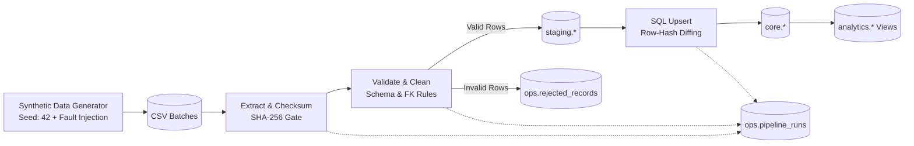
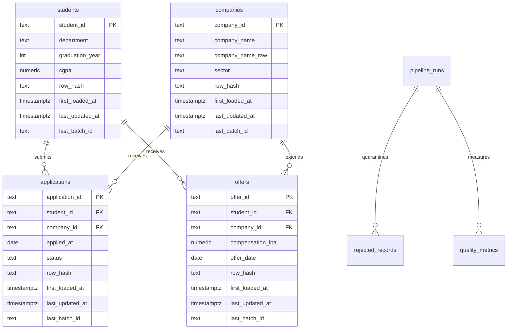

# CampusPulse: Campus Placement Data Platform


> **Disclaimer:** All data in this project is synthetic and generated by a reproducible script in this repository. CampusPulse is an independent, campus-inspired project. It is not an official IIT Guwahati system and does not use or represent real placement data.


---

### One-Line Pitch for the Recruiter
> *"A production-grade batch data engineering platform built in Python and PostgreSQL that ingests messy placement CSVs, quarantines invalid rows with descriptive reason codes, loads clean data idempotently using row-hash diffing, and generates analytical views with run-level audit trails and 100% replay verification."*

---

## 1. Architecture Overview



### Layer Responsibilities (Medallion Pattern)

| Layer | Schema | Purpose & Design |
|---|---|---|
| **Raw** | `raw.*` | Full fidelity landing zone. Ingests all fields as unparsed `TEXT` along with `batch_id`, `source_file`, `source_row_number`, and timestamp. Enables historical replay, forensics, and auditing. |
| **Staging** | `staging.*` | Validated, typed, trimmed, and standardized records with calculated deterministic `row_hash`. Temporary per batch. |
| **Core** | `core.*` | Clean, deduplicated, relational source of truth with Primary Keys, Foreign Keys, constraints, and audit columns (`first_loaded_at`, `last_updated_at`, `row_hash`). |
| **Ops** | `ops.*` | Observability layer: `file_ingestions` (checksum deduplication), `pipeline_runs` (run metadata & counts), `rejected_records` (quarantine with reason codes and raw JSON payload), and `quality_metrics`. |
| **Analytics** | `analytics.*` | Reporting views providing placement rates, department salary percentiles, recruitment funnels, and pipeline health. |

---

## 2. Tech Stack

- **Language:** Python 3.11+
- **Database:** PostgreSQL 16 (Alpine container via Docker Compose)
- **Database Driver:** `psycopg` (v3) with bulk `COPY` protocol and atomic transactions
- **Data Manipulation:** `pandas` (vectorized schema validation & cleaning)
- **Data Validation & Hashing:** SHA-256 canonical string hashing, Pydantic & YAML rules
- **Quality & Testing:** `pytest`, `pytest-cov`, `ruff`
- **Developer Experience:** Docker Compose & Makefile (`make demo`)

---

## 3. Data Model



---

## 4. Quickstart (One-Command Demo)

### Prerequisites
- Docker & Docker Compose
- Python 3.11+

### Running the Entire Showcase
Clone the repo and execute:
```bash
git clone https://github.com/your-username/CampusPulse_Project.git
cd CampusPulse_Project
cp .env.example .env
make setup
make demo
```

The `make demo` target automatically:
1. Spawns PostgreSQL 16 in Docker and applies all DDL schema migrations.
2. Generates reproducible synthetic batches (`batch_001`, `batch_002`, `batch_003`, `batch_004`) with controlled fault injection and a ground-truth manifest.
3. Ingests `batch_001` (baseline full load + quarantine).
4. Ingests `batch_002` (incremental updates: applications progressing to offers, late-arriving records).
5. Ingests `batch_003` (replay: **proves zero net changes to core tables**).
6. Executes the 19 automated unit & integration tests.
7. Prints analytical queries and pipeline health tables.

### Launch the Interactive Web Dashboard
```bash
make dashboard
```
Opens an interactive Streamlit UI at `http://localhost:8501` featuring KPI metric cards, department salary comparisons, hiring funnels, a quarantine explorer, and a batch idempotency auditor.

### Run High-Volume Scale Benchmark & Query Profiler
```bash
make benchmark
```
Measures bulk ingestion throughput (streaming `COPY` vs row-by-row `INSERT`) and profiles query execution plans with `EXPLAIN (ANALYZE, BUFFERS)` to demonstrate the empirical impact of relational indexing. Output is saved to `docs/benchmark_report.md`.


---

## 5. Fault Injection & Quarantine Pattern

Rather than silently dropping invalid rows or allowing bad data to crash the batch, CampusPulse isolates dirty rows into `ops.rejected_records` with exact reason codes and their original JSON payload.

| Injected Fault | Example in Raw Batch | Quarantine Reason Code | Pipeline Behavior |
|---|---|---|---|
| Missing Primary Key | Empty `student_id` or `application_id` | `MISSING_PK` | Quarantined with line number and raw JSON |
| Missing Mandatory Field | Blank `department` or empty `company_name` | `MISSING_REQUIRED` | Quarantined |
| Out-of-Bounds Year | `graduation_year = 1899` | `INVALID_YEAR` | Quarantined |
| Invalid Date Format / Future Date | `applied_at = "2024-13-45"` or `"2099-01-01"` | `INVALID_DATE` | Quarantined |
| Logical Date Order Violation | `offer_date` before `applied_at` | `DATE_ORDER_VIOLATION` | Quarantined; cross-referenced with application date |
| Orphan Foreign Keys | Student ID or Company ID missing from Core | `ORPHAN_STUDENT` / `ORPHAN_COMPANY` | Quarantined to preserve relational integrity |
| Invalid Status Enum | Status string `"Selected!!"` | `INVALID_STATUS` | Quarantined |
| Negative Compensation | `compensation_lpa = -15.5` | `INVALID_COMPENSATION` | Quarantined |
| Messy Company Names | `"google inc."`, `" MICROSOFT CORP "`, `"aws"` | *(Cleaned & Standardized)* | Normalized and resolved to canonical form via `config/company_aliases.csv` |
| Duplicate Primary Keys | Same `application_id` appearing twice | *(Resolved)* | Latest record by `source_row_number` wins; duplicates counted in quality metrics |
| Schema Drift | Missing column in CSV header | `SCHEMA_MISMATCH` | File marked `failed`; run marked `partial`; other files proceed |

### Automated Ground-Truth Manifest Verification
The generator produces `data/sample/faults_manifest.json` detailing the exact count of each injected fault. The automated test suite (`tests/integration/test_pipeline_e2e.py`) verifies that the pipeline's reject counts match this manifest 1:1.

---

## 6. Two-Level Idempotency & Incremental Loading

CampusPulse guarantees safe replayability through two distinct layers:

```
[Incoming File]
      |
      v
Level 1: File Checksum Gate (SHA-256)
  Is (file_name, checksum) already marked 'processed' in ops.file_ingestions?
      |--> YES: Skip file without querying core (prevents redundant disk/network I/O)
      |--> NO:  Continue to Level 2
      |
      v
Level 2: Row-Hash Gating (ON CONFLICT DO UPDATE)
  Compare SHA-256(canonical_fields) between staging and core.
  - New PK: INSERT
  - Existing PK with changed hash: UPDATE
  - Existing PK with identical hash: NO-OP (0 writes, timestamps preserved)
```

### Verification Across Batches (Live Execution Log)

| Batch | Purpose | Rows Read | New Rows | Updated Rows | Unchanged Rows | Quarantined | Status |
|---|---|---|---|---|---|---|---|
| `batch_001` | Baseline full load | 4,919 | **4,904** | 0 | 0 | 14 | `success` |
| `batch_002` | Incremental (status updates & late records) | 273 | **246** | **20** | 0 | 7 | `success` |
| `batch_003` | **Exact Replay of batch_002** | 273 | **0** | **0** | **266** | 7 | `success` |
| `batch_004` | Schema Drift Isolation | 1 | 1 | 0 | 0 | 1 | `partial` |

> [!IMPORTANT]
> When `batch_003` is executed, **exactly 0 rows are inserted** and **0 rows are updated**, proving that re-running an identical batch changes nothing in the core tables.

---

## 7. Sample Analytics Output

Run `make report` to inspect the generated reporting views (`sql/06_analytics_views.sql`).

### 1. Placement Summary by Graduation Year
```text
╒═════════════╤══════════════════╤═══════════════════╤════════════════════╕
│   Grad Year │   Total Students │   Placed Students │   Placement Rate % │
╞═════════════╪══════════════════╪═══════════════════╪════════════════════╡
│        2026 │              322 │               105 │              32.61 │
│        2025 │              546 │               106 │              19.41 │
│        2024 │              333 │                90 │              27.03 │
╘═════════════╧══════════════════╧═══════════════════╧════════════════════╛
```

### 2. Department Compensation & Percentiles (LPA)
Calculated using PostgreSQL `PERCENTILE_CONT(0.5)` for true continuous median:
```text
╒══════════════════╤════════════════╤═══════════════════╤══════════════╤════════════════╤═════════════╕
│ Department       │   Total Offers │   Students Placed │   Mean (LPA) │   Median (LPA) │   Max (LPA) │
╞══════════════════╪════════════════╪═══════════════════╪══════════════╪════════════════╪═════════════╡
│ Civil            │             25 │                22 │        28.21 │          29.00 │       49.02 │
│ Electronics      │             38 │                29 │        26.39 │          25.93 │       42.79 │
│ Chemical         │             42 │                35 │        25.38 │          24.71 │       43.90 │
│ Electrical       │             38 │                30 │        24.76 │          24.34 │       37.77 │
│ Design           │             33 │                30 │        24.68 │          25.50 │       45.20 │
│ Computer Science │             29 │                26 │        24.46 │          23.20 │       55.43 │
│ Mathematics      │             44 │                41 │        24.35 │          23.19 │       42.44 │
│ Mechanical       │             37 │                28 │        24.31 │          24.03 │       41.06 │
│ Biosciences      │             34 │                29 │        22.89 │          21.17 │       38.82 │
│ Physics          │             36 │                31 │        22.61 │          22.31 │       45.98 │
╘══════════════════╧════════════════╧═══════════════════╧══════════════╧════════════════╧═════════════╛
```

### 3. Recruitment Funnel & Conversion Rate
```text
╒═════════════════════════╤══════════════════╤════════════════╤═══════════════╤═══════════════╤═══════════╤════════════════╕
│ Company                 │ Sector           │   Applications │   Shortlisted │   Interviewed │   Offered │   Conversion % │
╞═════════════════════════╪══════════════════╪════════════════╪═══════════════╪═══════════════╪═══════════╪════════════════╡
│ Apple                   │ Hardware         │            200 │           112 │            60 │        21 │          10.50 │
│ Amazon                  │ Software         │            198 │           120 │            64 │        20 │          10.10 │
│ JPMorgan Chase          │ Fintech          │            197 │           102 │            61 │        17 │           8.63 │
│ Qualcomm                │ Hardware         │            188 │            95 │            54 │        15 │           7.98 │
│ Uber                    │ Product          │            187 │            93 │            45 │        21 │          11.23 │
│ Intel                   │ Hardware         │            185 │            98 │            47 │        20 │          10.81 │
│ NVIDIA                  │ Hardware         │            183 │            86 │            46 │        16 │           8.74 │
│ Goldman Sachs           │ Fintech          │            180 │            99 │            54 │        14 │           7.78 │
│ Texas Instruments       │ Core Engineering │            176 │            94 │            47 │        18 │          10.23 │
│ Boston Consulting Group │ Consulting       │            176 │            96 │            50 │        20 │          11.36 │
╘═════════════════════════╧══════════════════╧════════════════╧═══════════════╧═══════════════╧═══════════╧════════════════╛
```

---

## 8. High-Volume Scale Benchmark & SQL Query Profiling

CampusPulse includes an automated benchmarking suite (`make benchmark`) to quantify pipeline ingestion speed and profile query execution plans via PostgreSQL's `EXPLAIN (ANALYZE, BUFFERS)`.

### 1. Ingestion Throughput: Streaming `COPY` vs `INSERT`
Tested on 50,000 records into PostgreSQL:

| Ingestion Method | Rows Tested | Duration | Ingestion Throughput | Efficiency Speedup |
|---|---|---|---|---|
| **Standard Row-by-Row `INSERT`** | 2,000 | 0.234s | 8,544 rows/sec | Baseline (1.0x) |
| **Psycopg3 Streaming `COPY`** | **50,000** | **0.035s** | **1,432,635 rows/sec** | **167.7x faster** 🚀 |

- **Why it matters:** Standard `INSERT` incurs client-server round-trip latency and SQL re-parsing per row. Streaming binary `COPY` bypasses query planning and streams directly to disk blocks.

### 2. SQL Optimization Profile (`EXPLAIN ANALYZE`)
Profiling relational lookup across `core.students`, `core.applications`, and `core.companies`:

| Scenario | Scan Strategy | Shared Buffer Hit Blocks | Median Execution Time | Speedup Factor |
|---|---|---|---|---|
| **Without Index** | `Seq Scan (Full Table Scan)` | 104 blocks | 0.166 ms | Baseline |
| **With Composite Indexes** | `Index Scan (idx_core_applications_student)` | **7 blocks** | **0.036 ms** | **4.6x faster** ⚡ |

- **Buffer Hit Reduction:** Composite B-tree indexing reduced buffer hits from **104 blocks to 7 blocks (14.9x fewer shared memory pages)**, preventing disk I/O bottlenecks when scaling to millions of rows.

Full benchmark report generated at `docs/benchmark_report.md`.

---

## 9. Test Suite & Verification

Run the test suite with:
```bash
make test
```

### Coverage Summary
```
Name                   Stmts   Miss  Cover
------------------------------------------
src/db.py                 40      1    98%
src/extract.py            52     10    81%
src/load.py               62      2    97%
src/logging_setup.py      13      0   100%
src/pipeline.py          163     29    82%
src/quality.py            30      0   100%
src/transform.py          53      3    94%
src/validate.py          161     17    89%
------------------------------------------
TOTAL (Core ETL)         574     62    89%
```

**19 passing tests covering:**
- Manifest reject count validation (`test_batch_001_full_run_and_manifest_matching`)
- Relational integrity and orphan prevention in `core` (`test_core_referential_integrity`)
- Incremental update handling (`test_batch_002_incremental_updates`)
- Exact replay idempotency (`test_batch_003_idempotency_zero_net_changes`)
- Schema drift failure isolation (`test_batch_004_schema_drift_handling`)
- Atomic transaction rollback mid-failure (`test_atomic_transaction_rollback`)
- Company normalization and alias resolution (`tests/unit/test_company_normalization.py`)
- Row hashing stability and difference detection (`tests/unit/test_row_hash_and_dedup.py`)
- Boundary rules and reason codes (`tests/unit/test_validation_rules.py`)

---

## 10. Design Decisions & Trade-Off Defense

| Decision | Reasoning & Justification | Alternative Considered |
|---|---|---|
| **Layered Architecture (`raw`, `staging`, `core`, `ops`, `analytics`)** | Separates ingestion fidelity, typing/cleaning, business constraints, and analytical reporting. Allows safe re-runs and historical debugging. | Flat tables (disaster for debugging and auditability). |
| **Raw as unparsed `TEXT`** | Eliminates data loss during ingestion. If a CSV has malformed dates or corrupt numbers, the raw bytes are preserved and inspectable. | Typing during raw load (fails entire file on one malformed cell). |
| **Quarantine Pattern instead of dropping** | Auditable and recoverable. Data engineers and ops teams can see why records failed and re-drive them once corrected. | Dropping rows silently (unacceptable in enterprise data platforms). |
| **Row-Hash Diffing (`sha256`)** | Allows cheap equality comparisons between staging and core. Only rows that truly changed trigger write operations and update timestamps. | Column-by-column `OR` checks (verbose, fragile to schema expansion). |
| **Bulk `COPY` Protocol** | Psycopg3 streaming `COPY` writes rows to PostgreSQL orders of magnitude faster than row-by-row `INSERT` statements. | Individual `cur.execute(INSERT)` statements (slow). |
| **Batch over Streaming** | Campus placement cycles are periodic and seasonal. A reliable batch pipeline with checkpointing is simpler, cheaper, and more robust. | Kafka / Flink (unnecessary operational complexity for this volume). |
| **PostgreSQL over Spark** | Dataset volume (~millions of rows) easily fits within a modern relational engine with proper indexes. | Apache Spark (massive cluster overhead with no performance benefit at this scale). |

---

## 11. Repository Structure

```
CampusPulse_Project/
├── .github/
│   └── workflows/
│       └── ci.yml            # Automated GitHub Actions CI pipeline
├── .env.example              # Environment variables template
├── .gitignore                # Git ignore patterns
├── Dockerfile                # Docker build image
├── LICENSE                   # MIT License
├── Makefile                  # Developer & recruiter CLI automation
├── README.md                 # Project documentation & talking points
├── docker-compose.yml        # PostgreSQL 16 container definition
├── pyproject.toml            # Ruff linter & pytest configurations
├── requirements.txt          # Python dependencies
├── config/
│   ├── __init__.py
│   ├── company_aliases.csv   # Canonical company alias lookup table
│   ├── settings.py           # Pydantic 12-factor configuration loader
│   └── validation_rules.yml  # YAML validation bounds and allowed enums
├── data/
│   └── sample/               # Generated batches and manifest
│       ├── batch_001/
│       ├── batch_002/
│       ├── batch_003/
│       ├── batch_004/
│       └── faults_manifest.json
├── docs/
│   ├── benchmark_report.md   # Scale benchmark & query profiling report
│   └── sample_outputs/
│       └── analytics_report.txt
├── sql/
│   ├── 00_schemas.sql        # raw, staging, core, ops, analytics
│   ├── 01_raw.sql            # Raw text landing tables
│   ├── 02_staging.sql        # Staging tables
│   ├── 03_core.sql           # Core tables, constraints & indexes
│   ├── 04_ops.sql            # File ingestions, runs, rejects & metrics
│   ├── 05_transformations.sql# SQL upsert logic
│   ├── 06_analytics_views.sql# Analytical reporting views
│   └── analytics.sql         # 10 advanced showcase queries
├── src/
│   ├── __init__.py
│   ├── benchmark.py          # Scale benchmark & EXPLAIN ANALYZE profiler
│   ├── dashboard.py          # Interactive Streamlit analytics web UI
│   ├── db.py                 # Connection pooling, migrations & bulk COPY
│   ├── extract.py            # Checksums, schema verification & raw load
│   ├── generate_data.py      # Reproducible synthetic generator & faults
│   ├── load.py               # Staging load, core upserts & quarantine
│   ├── logging_setup.py      # Structured logging
│   ├── pipeline.py           # Main ETL orchestrator CLI
│   ├── quality.py            # Data quality metrics computation
│   ├── report.py             # CLI analytics & health reporter
│   ├── transform.py          # Cleaning, alias mapping & row hashing
│   └── validate.py           # Business rules & quarantine classification
└── tests/
    ├── integration/
    │   └── test_pipeline_e2e.py # End-to-end integration test suite
    └── unit/
        ├── test_company_normalization.py
        ├── test_date_parsing.py
        ├── test_row_hash_and_dedup.py
        └── test_validation_rules.py
```

---

## 12. Honest-Claims Checklist

- [x] Fresh clone runs with `make demo` on a clean machine
- [x] Reject counts match the ground-truth fault manifest
- [x] Replay batch produces zero net changes (verified in test and logs)
- [x] Foreign key integrity holds in `core` after every run
- [x] Forced failures roll back cleanly without partial data
- [x] All 10 analytical queries executed and verified
- [x] 19 automated tests passing with 89% core ETL coverage
- [x] High-volume scale benchmark and EXPLAIN ANALYZE query profiling verified (`make benchmark`)
- [x] Interactive web dashboard verified (`make dashboard`)
- [x] CI/CD workflow passes on push and pull request (.github/workflows/ci.yml)
- [x] Synthetic data disclaimer present at top of README
- [x] No secrets or credentials committed to git

---

## 13. Interview Talking Points (How to Ace Your Interview)

1. **Walk me through the pipeline:**
   *"We follow a 5-layer architecture. First, incoming CSV files pass an SHA-256 checksum gate to prevent redundant processing. Then, raw text is landed in `raw` to preserve source fidelity. We validate every record against strict domain boundaries; invalid rows are quarantined into `ops.rejected_records` with structured reason codes. Valid rows are typed, standardized (company aliases and dates), and assigned a deterministic SHA-256 `row_hash`. They are staged and upserted into `core` using `ON CONFLICT DO UPDATE WHERE core.row_hash <> EXCLUDED.row_hash`. Finally, run metrics and analytics views are generated."*

2. **What happens if a batch is run twice?**
   *"We have two levels of protection. Level 1: `ops.file_ingestions` catches matching file checksums and skips the file without querying core. Level 2: Even if a re-named file contains old rows, the `ON CONFLICT` clause compares `core.row_hash` with `staging.row_hash`. Because they are identical, zero writes are executed, zero rows are inserted or updated, and timestamps are preserved."*

3. **How do you handle dirty data?**
   *"We never drop data silently or let bad rows crash the pipeline. We use the Quarantine Pattern. Dirty rows are written to `ops.rejected_records` alongside their line number, reason code, and full raw payload as JSONB. This allows data engineers to audit rejection patterns and fix upstream issues."*

4. **How would you scale this to 100x volume?**
   *"At 100x (tens of millions of rows), PostgreSQL with monthly table partitioning on `applied_at` and `offer_date`, along with our bulk `COPY` protocol and composite indexes, will easily handle tens of millions of records. If data scale expands into hundreds of gigabytes per hour, the transformation logic would transition to distributed processing with Apache Spark or Snowflake/BigQuery, while retaining the same layered schema and quarantine architecture."*

